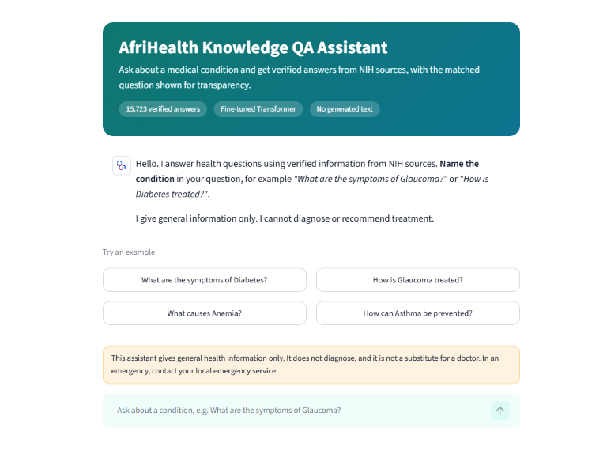
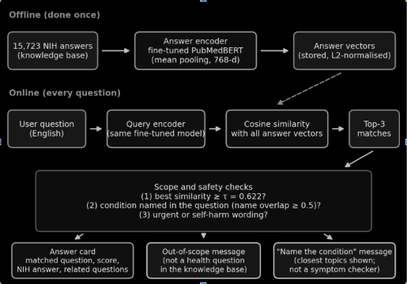
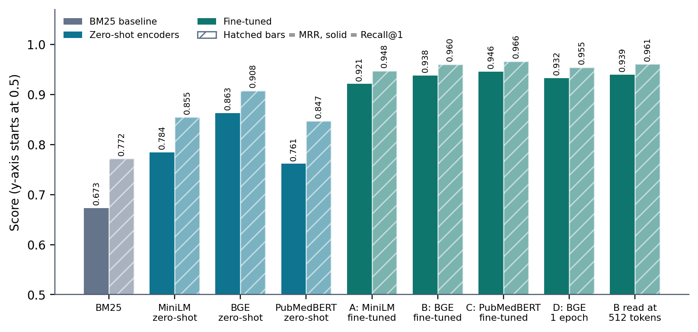
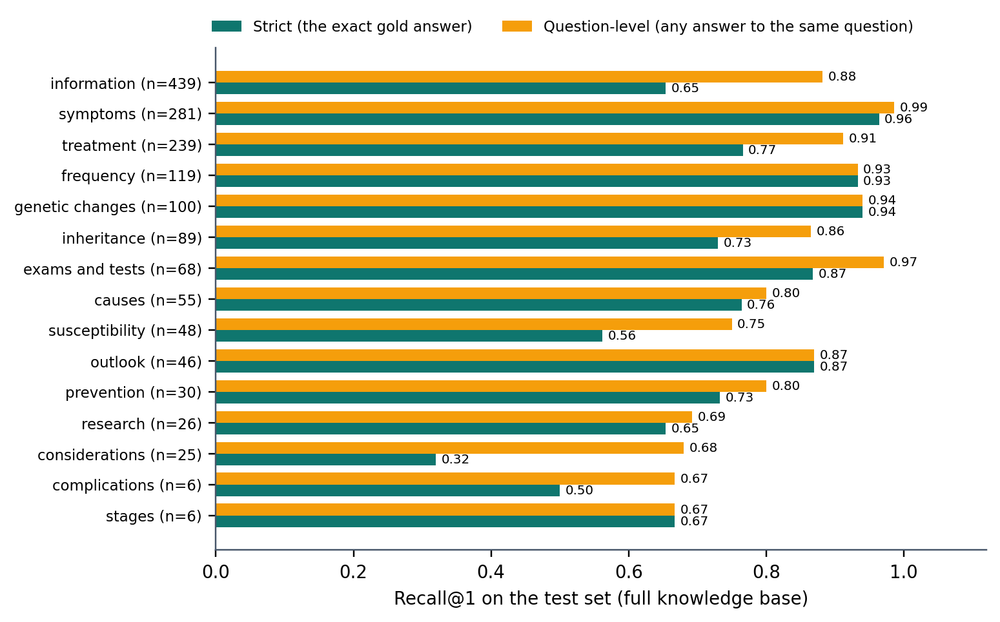
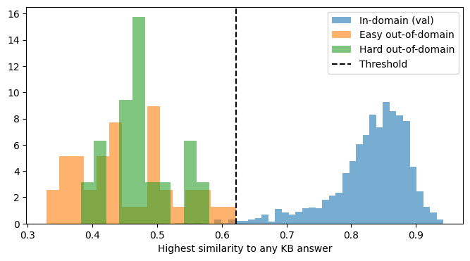

#AfriHealth Knowledge QA Assistant

**An English question-answering assistant that explains diseases, their causes, symptoms and prevention using verified NIH answers.** A PubMedBERT-based sentence encoder is fine-tuned to retrieve the right answer, and a Streamlit app lets anyone try it.

[**Live app**](https://healthcare-app-assistantgit-guirh2pigtwxsznug8wgo7.streamlit.app/) · [**Model on Hugging Face**](https://huggingface.co/alain-ngabo/healthcare-qa-retriever) · [**Full report (docs)**](https://docs.google.com/document/d/1H3MvjqkjYZ0pPuELIEZQ0YllMPTDcTh1EaEeRyeRpkM/edit?usp=sharing) · [**Demo video**](https://youtu.be/Qe0a4eTfdFQ)




> **Not medical advice.** The assistant gives general information from NIH sources. It does not diagnose, and it must not be used in an emergency.

---

## Contents

1. [At a glance](#1-at-a-glance)
2. [Why this project](#2-why-this-project)
3. [What the assistant does](#3-what-the-assistant-does)
4. [How it works](#4-how-it-works)
5. [Data](#5-data)
6. [Experiments](#6-experiments)
7. [Results and error analysis](#7-results-and-error-analysis)
8. [Repository structure](#8-repository-structure)
9. [Reproduce the results](#9-reproduce-the-results)
10. [Run the app and deploy it](#10-run-the-app-and-deploy-it)
11. [Limitations, safety and future work](#11-limitations-safety-and-future-work)
12. [Licences](#12-licences)
13. [Cite and contact](#13-cite-and-contact)

---

## 1. At a glance

| | |
|---|---|
| **Task** | Domain-specific question answering (health), English |
| **Approach** | Retrieval, not generation: a fine-tuned bi-encoder returns the best stored NIH answer |
| **Data** | MedQuAD: 15,786 cleaned question–answer pairs, 15,723 distinct answers |
| **Model** | `NeuML/pubmedbert-base-embeddings`, fine-tuned with in-batch negatives (3 epochs, about 18 min on 2 GPUs) |
| **Best result** | Recall@1 **0.935** and MRR **0.961** on held-out test questions (BM25: 0.677 and 0.769) |
| **In the real app** (15,723 answers to search) | Recall@1 **0.782** strict, **0.899** when any answer to the same question counts |
| **Out-of-domain questions** | 99.6% of real questions answered, 28 of 28 non-medical test questions rejected |
| **Known weak spot** | Cannot map symptom descriptions to conditions (Hit@5 0.07), so the app asks users to name the condition |
| **Deployment** | Streamlit Community Cloud, model loaded from the Hugging Face Hub |

---

## 2. Why this project

Africa faces a double burden of disease. Non-communicable diseases (NCDs) such as diabetes, hypertension and cancer are rising alongside infectious diseases, and much of the burden goes unrecognised:

- NCDs' share of disease burden in sub-Saharan Africa rose from 18.6% to 29.8% between 1990 and 2017 (Gouda et al., 2019).
- About 73% of adults with diabetes in Africa are undiagnosed (International Diabetes Federation, 2025).
- Only about 27% of adults with hypertension in sub-Saharan Africa were aware of their condition (Ataklte et al., 2015).

Reliable, plain-language information about what a disease is, what causes it, which symptoms to notice and how it can be prevented is a first step towards earlier care. English is one of Rwanda's three official languages, and the authoritative NIH health content is published in English.

**Design choice: select answers, never write them.** Generated text can contain fluent statements that no source supports (Ji et al., 2023), which is unacceptable for health. This assistant therefore returns an existing NIH answer, shows the question it matched, and declines questions it cannot answer.

---

## 3. What the assistant does

- **Answers questions about a named condition**, for example *"What are the symptoms of Glaucoma?"* or *"How is Diabetes treated?"*. It handles paraphrases: *"How is Diabetes treated?"* is matched to *"What are the treatments for Diabetes?"*.
- **Shows its work.** Each answer card shows the matched question, a similarity score ("strong" or "possible" match), the NIH answer with an expandable full text, and related questions.
- **Declines out-of-scope questions.** *"How do I bake a chocolate cake?"* scores 0.487, below the threshold of 0.622, and is declined.
- **Does not pretend to be a symptom checker.** If no condition is named (for example *"I am very thirsty and urinate often"*), it says so and lists the closest topics instead of guessing.
- **Safety rules.** Emergency wording adds an urgent-care notice, self-harm wording gets a supportive message and no retrieved text, and every answer carries a disclaimer.

---

## 4. How it works



1. **Offline:** the fine-tuned encoder turns every answer into a 768-number vector (mean pooling, unit length). The 15,723 vectors are stored in `app/kb_embeddings.npy`.
2. **Online:** the same encoder turns the question into a vector. Its dot product with all stored vectors is the cosine similarity, and the top three answers are kept.
3. **Checks:** a similarity threshold (τ = 0.622) rejects out-of-domain questions, and a name check asks the user to name the condition when it is missing.

**Fine-tuning.** The model is a bi-encoder: one Transformer shared by questions and answers. It is trained with the *multiple negatives ranking loss*. In each batch, a question should be closest to its own answer, and every other answer in the batch acts as a negative:

`L = −(1/B) Σᵢ log [ exp(s·cos(qᵢ, aᵢ)) / Σⱼ exp(s·cos(qᵢ, aⱼ)) ]`, with scale `s = 20`.

<details>
<summary><b>Training settings</b></summary>

| Setting | Value |
|---|---|
| Training pairs | 12,624 (question → answer) |
| Optimiser | AdamW, linear learning-rate decay after warm-up |
| Learning rate | 2e-5 |
| Batch size | 32 per GPU on 2 GPUs (64 pairs per step) |
| Epochs | 3 |
| Maximum input length | 256 tokens |
| Warm-up | 118 steps (about 20% of the roughly 594 steps, because the 10% rule assumed one GPU) |
| Precision and seed | fp16, seed 42 |
| Selection | Highest validation MRR; the test set is used once at the end |

</details>

---

## 5. Data

**Source.** [MedQuAD](https://github.com/abachaa/MedQuAD) (Ben Abacha & Demner-Fushman, 2019) collects question–answer pairs from NIH websites. The project uses a community copy on Hugging Face ([`keivalya/MedQuad-MedicalQnADataset`](https://huggingface.co/datasets/keivalya/MedQuad-MedicalQnADataset), 16,407 rows). The answers are real, expert-curated text; none were generated by a language model. The questions, however, follow fixed templates (for example "What are the symptoms of X?"), so they are not real user questions.

**Cleaning** (notebook 01):

| Step | Pairs remaining | Removed |
|---|---:|---:|
| Raw data | 16,407 | – |
| Answers shorter than 10 words | 16,328 | 79 |
| Exact duplicate pairs | 16,280 | 48 |
| Boilerplate answers (one answer reused by more than 5 questions) | 15,786 | 494 |

Boilerplate was ten answers such as a generic "inherited in an autosomal recessive pattern" sentence reused by 348 questions. Hundreds of questions sharing one positive answer is a contradictory training signal.

**Split by answer, not by row.** Each distinct answer gets a hash, and a grouped split keeps all questions with the same answer in one split. The notebook asserts that no answer appears in two splits: **12,624 train / 1,585 validation / 1,577 test**. Without this, scores would be inflated by answer leakage.

**What it covers.** The knowledge base is strong on the NCDs that motivate the project and weak on tropical infectious diseases:

| Condition | Questions | Condition | Questions |
|---|---:|---|---:|
| cancer | 538 | malaria | 3 |
| diabetes | 209 | tuberculosis | 6 |
| anemia | 142 | HIV | 7 |
| stroke | 66 | typhoid / cholera / Ebola | 1 each |
| hypertension / asthma | 16 each | COVID-19 | 0 |

---

## 6. Experiments

Four research questions: (1) does fine-tuning beat BM25 and the same encoders used zero-shot, (2) does a biomedical encoder win after fine-tuning, (3) how much do epochs and input length matter, (4) how are out-of-domain and symptom-style questions handled. All choices were made on the validation split.



| System | Recall@1 | Recall@5 | MRR | Training |
|---|---:|---:|---:|---:|
| BM25 (baseline) | 0.673 | 0.888 | 0.772 | – |
| MiniLM-L6, zero-shot | 0.784 | 0.937 | 0.855 | – |
| BGE-base, zero-shot | 0.863 | 0.962 | 0.908 | – |
| PubMedBERT encoder, zero-shot | 0.762 | 0.948 | 0.847 | – |
| A: MiniLM, fine-tuned 3 epochs | 0.921 | 0.980 | 0.948 | 3.6 min |
| B: BGE, fine-tuned 3 epochs | 0.938 | 0.987 | 0.960 | 18.7 min |
| **C: PubMedBERT encoder, fine-tuned 3 epochs** | **0.946** | **0.989** | **0.966** | 18.0 min |
| D: BGE, fine-tuned 1 epoch | 0.933 | 0.982 | 0.955 | 6.2 min |

**What we learned**

- **Fine-tuning matters most.** It added 18.4 points of Recall@1 to the PubMedBERT encoder, 13.7 to MiniLM and 7.5 to BGE.
- **The biomedical encoder was the weakest zero-shot and the best after fine-tuning**, but only by about 12 questions over BGE, so the two are treated as comparable.
- **Epochs and input length matter little.** One epoch instead of three costs 0.6 points; reading 512 instead of 256 tokens changes Recall@1 by 0.1 points.
- **Noise.** A repeat of run C scored 0.9464 against 0.9457, so differences under about one point are within run-to-run noise (single seed per configuration).

---

## 7. Results and error analysis

**Held-out test set** (1,577 questions, used once):

| System | Answers searched | Recall@1 | Recall@5 | MRR |
|---|---:|---:|---:|---:|
| BM25 (baseline) | 1,573 | 0.677 | 0.880 | 0.769 |
| Same encoder, zero-shot | 1,573 | 0.774 | 0.938 | 0.850 |
| **Fine-tuned (final model)** | 1,573 | **0.935** | **0.992** | **0.961** |
| Fine-tuned, full knowledge base (as in the app) | 15,723 | 0.782 | 0.942 | 0.856 |

**Strict versus question-level accuracy.** MedQuAD repeats some questions with different valid answers from different sources. Counting an answer to the *same question text* as correct raises Recall@1 on the full knowledge base from **0.782 to 0.899** (Recall@5: 0.942 to 0.980). Both numbers are reported because the strict one is a reproducible lower bound and the question-level one is closer to what a user experiences.

**Where the 344 errors come from**

| Error type | Count | Share |
|---|---:|---:|
| Same question text (another valid answer ranked first) | 184 | 53.5% |
| Right topic, wrong aspect (for example a description instead of risk factors) | 61 | 17.7% |
| Similar topic name | 50 | 14.5% |
| Unrelated topic by word overlap (often a close neighbour, such as *Neurofibromatosis* and *Neurofibroma*) | 31 | 9.0% |
| Right topic, same type, different answer | 18 | 5.2% |

For 73.5% of the errors the gold answer was still in the top five. Some "errors" are data errors: the gold answer for *"What are the treatments for Machado-Joseph Disease?"* is a sentence about Lyme disease.

<details>
<summary><b>Results by question type</b></summary>



Templated types are easiest (symptoms 0.96, genetic changes 0.94, frequency 0.93). The largest group, information ("What is (are) X?", 28% of the test set), scores 0.65 strictly but 0.88 at question level. Types with fewer than 30 questions give unstable estimates.

</details>

**Scope handling.** The threshold τ = 0.622 was chosen on validation data only. On the test set it answers 99.6% of in-domain questions and rejects all 20 easy and all 8 hard out-of-domain questions (the hard ones copy medical wording, for example *"What are the symptoms of a bad car alternator?"*). The set is small, so 100% is not a guarantee. A higher threshold barely improves precision, because most errors are similar answers, not low-similarity guesses.



**Symptom-style queries.** Of 14 symptom descriptions, the fine-tuned model placed the expected condition in its top five for 1 (Hit@5 0.07) and the zero-shot encoder for 2 (0.14). The training pairs always contain the disease name, so the model learns to match names, not symptoms. This is why the app asks users to name the condition.

---

## 8. Repository structure

```
healthcare-qa-assistant/
├── README.md
├── requirements.txt             Notebook environment 
├── .gitignore
├── .streamlit/config.toml       App theme and settings
├── app/
│   ├── app.py                   Streamlit application
│   ├── check.py                 Command-line test of the model and knowledge base
│   ├── requirements.txt         App dependencies (used by Streamlit Cloud)
│   ├── config.json              Threshold, query prefix, max length, model repo
│   ├── kb.csv                   15,723 questions and NIH answers
│   └── kb_embeddings.npy        Stored answer vectors (float16)
├── scripts/
│   └── notebooks/
│       ├── 01_data_preparation.ipynb
│       ├── 02_baselines.ipynb
│       ├── 03_tuning_experiments.ipynb
│       └── 04_final_evaluations.ipynb
├── results/                     Metrics (CSV), plots and error-analysis files
├── docs/                        Figures used in this README
└── data/README.md               project explanation
```

---

## 9. Reproduce the results

The notebooks run on Kaggle. **Kaggle deletes `/kaggle/working` when a session ends**, so run each notebook with *Save Version → Save & Run All*, and download its output.

| Step | Notebook | Kaggle settings | Needs | Time |
|---|---|---|---|---|
| 1 | `01_data_preparation` | Internet on | – | ~5 min |
| 2 | `02_baselines` (optional) | GPU, Internet on | output of 01 | ~10 min |
| 3 | `03_tuning_experiments` | GPU (2×T4), Internet on | output of 01 | ~50 min |
| 4 | `04_final_evaluations` | GPU, Internet on | outputs of 01 and 03 | ~15 min |

1. Create a Kaggle notebook from each file, set the options above, and attach the outputs of earlier steps with **Add Input → Your Work**.
2. Each notebook prints the paths of the files it loaded, so check that they are the newest ones.
3. Notebook 04 also writes the knowledge-base files (`kb.csv`, `kb_embeddings.npy`, `config.json`) that the app uses, and can push the final model to the Hugging Face Hub.
4. A Hugging Face token is optional (it only removes a download warning). Add it as a Kaggle secret named `HF_TOKEN`. **Never put a token in a notebook or in Git.**

Everything is seeded (42), but GPU training is not bit-for-bit deterministic. Expect differences of about 0.1 points of Recall@1. Package versions are in `requirements.txt` (PyTorch 2.11.0, transformers 5.16.1, sentence-transformers 5.7.0).

---

## 10. Run the app and deploy it

**Run locally** (from the repository root, so the theme file is found):

```bash
python -m venv .venv
source .venv/bin/activate          # Windows (Git Bash): source .venv/Scripts/activate
pip install -r app/requirements.txt
python app/check.py                # optional: tests the model without the web page
streamlit run app/app.py
```

The app downloads the model from the Hub on the first start (about 440 MB). To use a local copy, put the model folder in `app/model/` or set the `MODEL_PATH` environment variable. Measured on a CPU-only machine: 7.3 s to load, 86 to 244 ms per question, about 1.1 GB peak memory.

**Deploy on Streamlit Community Cloud** (free):

1. Push the repository to GitHub (public) and run `python scripts/check_deploy.py`. It should report `0 failed`.
2. On [share.streamlit.io](https://share.streamlit.io), choose **Create app**, pick the repository and branch `main`, and set the main file path to `app/app.py`.
3. Under **Advanced settings** choose Python 3.12. A Hugging Face token is optional; if used, paste it in *Secrets* as `HF_TOKEN = "..."`.
4. Apps with no traffic for 12 hours sleep, so open the link before showing it.

Gradio Spaces needed a paid Hugging Face plan for new accounts, which is why the app uses Streamlit.

---

## 11. Limitations, safety and future work

**Limitations**

- **Data.** US NIH content with templated, not real, user questions; much of it concerns rare genetic conditions; thin coverage of malaria, tuberculosis and HIV. Some question–answer pairs are misaligned. Removing boilerplate means condition-specific inheritance answers are missing for those entries.
- **Model.** It selects stored answers and cannot combine or simplify them. It cannot link symptoms to diseases. Answers are read up to 256 tokens (34% are longer). Single seed per configuration.
- **Evaluation.** The strict metric under-counts valid answers, and the error taxonomy is a word-overlap heuristic. The out-of-domain (28) and symptom (14) query sets are smalle. The name check and safety rules were not measured quantitatively. No clinician has reviewed the answers and there was no user study.
- **System.** English only, static content, free hosting that sleeps.

**Safety and responsible use.** The assistant is for general education. It is not a substitute for a health professional, and in an emergency users must contact local emergency services. The knowledge base is NIH-sourced text used here for non-commercial, educational purposes; check upstream terms before any other reuse.

**Future work.** Add local sources (health-ministry and WHO material, with licences respected) for the diseases common in Africa; collect real user questions; build symptom-to-condition training data; mine hard negatives and re-rank with a cross-encoder; tune over several seeds; support Kinyarwanda; review answers with clinicians.

---

## 12. Licences

- **Code:** MIT licence (see `LICENSE`).
- **Model:** fine-tuned from [`NeuML/pubmedbert-base-embeddings`](https://huggingface.co/NeuML/pubmedbert-base-embeddings), which is released under the Apache 2.0 licence.
- **Data:** MedQuAD (Ben Abacha & Demner-Fushman, 2019), used for non-commercial, educational purposes. The Hugging Face copy does not state a licence.
- **Libraries:** PyTorch, Hugging Face Transformers and Datasets, sentence-transformers, scikit-learn, rank-bm25, pandas, NumPy, Matplotlib and Streamlit. Free GPUs and hosting came from Kaggle, Hugging Face and Streamlit.
**Key references** (the full list is in the [report](https://docs.google.com/document/d/1H3MvjqkjYZ0pPuELIEZQ0YllMPTDcTh1EaEeRyeRpkM/edit?usp=sharing)): Ben Abacha & Demner-Fushman (2019) MedQuAD; Reimers & Gurevych (2019) Sentence-BERT; Karpukhin et al. (2020) dense passage retrieval; Henderson et al. (2017) in-batch negatives; Gu et al. (2021) PubMedBERT; Thakur et al. (2021) BEIR; Robertson & Zaragoza (2009) BM25; Hendrycks & Gimpel (2017) out-of-distribution baseline; Laranjo et al. (2018) health conversational agents.

---

## 13. Contact and Citation

```bibtex
@misc{ngabo2026healthqa,
  author       = {Ngabo, Alain},
  title        = {Domain-Specific Health Question Answering in English: Fine-Tuning a Biomedical Transformer to Retrieve Verified NIH Answers},
  year         = {2026},
  howpublished = {GitHub repository},
  url          = {https://github.com/ai-ngabo/healthcare-qa-assistant}
}
```

**Author:** Alain Ngabo, Software Engineering, African Leadership University, Kigali, Rwanda · Hugging Face: [alain-ngabo](https://huggingface.co/alain-ngabo)